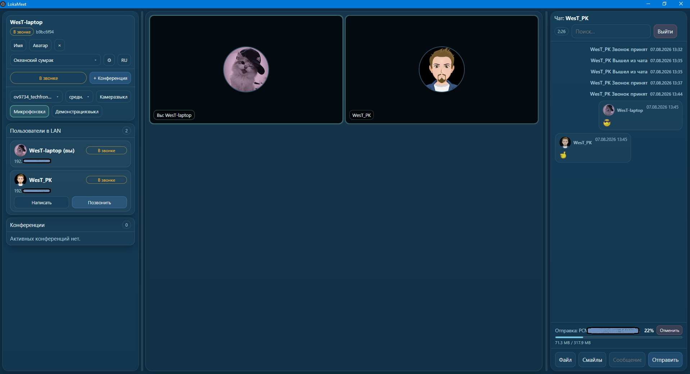

# LokaMeet (LAN Zoom-like, offline)

LokaMeet — десктоп‑приложение для видеосвязи в **локальной сети без интернета** (LAN‑only) с P2P‑подходом.

Этот файл — краткий обзор возможностей, быстрый старт и заметки по архитектуре.

## Интерфейс



## Быстрый старт (Windows)

Откройте PowerShell в корне репозитория — папке, где лежит `package.json`:

```powershell
npm install
npm run dev
```

## Проверка “2 экземпляра на одной машине”

### Через PowerShell

**Окно 1**

```powershell
$env:LOKAMEET_PROFILE="A"
npm run dev
```

**Окно 2 (в другом PowerShell)**

```powershell
$env:LOKAMEET_PROFILE="B"
npm run dev
```

### Через .bat

- `build_app.bat` — сборка
- `run_app.bat` — запуск (профиль A)
- `run_app_2.bat` — запуск (профиль B)
- `run_two_instances.bat` — запуск 2 экземпляров

## Что реализовано по ТЗ (актуально на текущий момент)

### 1) LAN‑only / P2P принципы

- **Работа без интернета**: медиаданные идут через WebRTC в LAN, сигналинг — через локальные WebSocket‑соединения.
- **Децентрализация**: каждый клиент поднимает свой signaling‑сервер и может быть “хостом” комнаты.

### 2) Обнаружение в сети (ТЗ 3.1.2)

- **Автообнаружение пользователей**:
  - mDNS/Bonjour (`bonjour-service`)
  - UDP‑broadcast фолбэк (когда mDNS блокируется)
- **Ручное подключение по IP/порту**: есть UI “подключиться вручную”.
- **Список пользователей/комнат** обновляется в реальном времени (по “last seen”).

### 3) Аудио/видео звонки (ТЗ 2.1)

- **Индивидуальные звонки** (аудио/видео) через WebRTC.
- **Групповые конференции**: реализовано как **mesh P2P**.
- **Вкл/выкл микрофона и видео**.
- **Выбор качества видео**: low/medium/high (через constraints).
- **Демонстрация экрана** (screen sharing).
- **Таймер длительности звонка** (приватный/групповой).

### 4) Чат (ТЗ 2.2)

- **Приватный чат** между двумя пользователями.
- **Групповой чат в конференции** (сообщения рассылает хост по участникам).
- **Локальная история сообщений** (в `state.json` в каталоге данных приложения: обычно `%AppData%\LokaMeet`, а для профилей A/B — `%AppData%\LokaMeet-A` / `%AppData%\LokaMeet-B`).
- **Поиск по сообщениям** (по тексту/имени файла).
- **Смайлы из папки `smiles/`** (если папка и файлы добавлены в проект):
  - меню “Смайлы” открывается вверх
  - клик вне меню закрывает
  - смайл **вставляется в поле ввода**, а не отправляется отдельно
- **Передача файлов** через WebRTC DataChannel + метаданные в чате (скачивание по ссылке).

### 5) Статусы (ТЗ 2.3)

- Статусы: **online / away / dnd / offline / in_call / in_conference**.
- **Цветовые индикаторы** в списке пользователей.
- Авто‑переключение статуса на `in_call` / `in_conference` во время звонка.

### 6) UI/UX (ТЗ 4)

- **9 тем оформления** (включая тёмные и светлые пресеты), **RU/EN локализация**.
- **Настройки UI**:
  - высота чата
  - ширина сайдбара
  - масштаб текста
  - компактный режим
  - показывать секунды
  - автопереход в чат при принятии звонка
  - автопрокрутка чата вниз
  - размер смайлов (px)
  - **лимит отображаемого диалога**: весь / последние 200/500/1000
- Окно настроек: **не прозрачное**, с возможностью перемещения (кастомный modal).

### 7) Логирование и диагностика (ТЗ 6.1)

- Подробные логи main и renderer в одном журнале, включая сетевые и WebRTC-события. В режиме разработки это обычно `logs/` в корне проекта; в сборке — папка `logs/` рядом с приложением либо каталог данных приложения, если основной путь недоступен.
- Глобальные обработчики `uncaughtException` / `unhandledRejection`.

## Крупные правки/фиксы, сделанные по ходу работ

- **Надёжность чата**:
  - устранена проблема “каждый видит только свои сообщения” (stale closure в обработчике envelopes)
  - дедупликация сообщений по `id` (убраны дубли у отправителя)
  - нормализация `direct`‑scope (ключ диалога — всегда “peerId собеседника”)
- **Конференции**:
  - хост больше не “эхо‑рассылает” сообщение обратно отправителю
  - устранено “комната закрывается/пропадает” из-за рассинхрона/соединений
  - `room-welcome` больше не зависит от того, успела ли комната появиться в списке
  - добавлен UDP‑анонс комнат как фолбэк к mDNS
- **WebRTC стабильность (LAN)**:
  - выбор более подходящего LAN‑IP (фильтрация виртуальных адаптеров)
  - фильтрация ICE‑candidate (предпочтение UDP и “близких” адресов)
  - принудительное использование реальных локальных IP (отключение mDNS‑hostnames для ICE)
  - устранение **мигания видео**: `srcObject` не переназначается на каждый рендер
  - не закрываем соединение мгновенно при `disconnected` (даём время восстановиться)
- **Верстка чата**:
  - исправлены “выезды” текста и клиппинг сообщений
  - сообщения теперь “пузырями”, корректное выравнивание и переносы

## Что осталось реализовать (по ТЗ) — честный чеклист

### Высокий приоритет (функциональность)

- **50 участников в одной конференции (ТЗ 2.1.1)**:
  - сейчас mesh P2P; для 50 нужен **SFU/MCU** (например, mediasoup/ion‑sfu/janus) — это отдельная большая подсистема.
- **Перевод индивидуального звонка в конференцию (ТЗ 2.1.2)**.
- **История звонков (ТЗ 2.1.2)**.

### Чат (доработки ТЗ 2.2)

- **Подтверждение прочтения сообщения собеседником**.
- **Системные уведомления ОС** и более детальные правила уведомлений. Звуковые уведомления (общий переключатель, громкость и файлы событий), подсветка непрочитанных чатов и предпросмотр изображений/видео уже реализованы.
- **Отправка файлов до 1GB**: сейчас DataChannel шлёт чанками, но целиком читается файл в память; нужно сделать **стриминг** (file→stream→chunk) и прогресс/возобновление.
- **Markdown/форматирование** (пока базовый текст + ссылки/смайлы).

### Управление конференциями (ТЗ 2.4)

- **Модерация** (назначение модераторов, кик/мьют участников со стороны хоста).
- **Режимы отображения**: speaker view, сетка 25 на экране.
- **Запись конференции** (локально).

### Настройки (ТЗ 4.2.3)

- **Расширенные сетевые настройки в UI**: выбор порта сигналинга, режима обнаружения и сетевых интерфейсов. Ручное подключение по IP/порту уже есть в «Настройки → Подключение».

### Безопасность (ТЗ 3.3)

- WebRTC уже использует **DTLS/SRTP** по умолчанию для медиа.
- **TLS для сигналинга** (WSS) не включён (в LAN обычно не требуется, но по ТЗ можно добавить опционально).

### Документация (ТЗ 7.2)

- Нужны отдельные документы:
  - инструкция установки
  - FAQ
  - (опционально) документация разработчика

## Сборка установщика / portable

```powershell
npm run dist
```

Сборки появятся в `release/`. Для создания установщика нужен ресурс `build/icon.png`; в текущем репозитории папки `build/`, `smiles/` и `snds/` отсутствуют, поэтому добавьте нужные локальные ресурсы перед полной сборкой.

## Важно про сеть (mDNS/Firewall)

Если пользователи/комнаты **не обнаруживаются**:

- Разрешите в Windows Firewall локальные входящие/исходящие соединения для приложения.
- Для mDNS нужен **UDP 5353**, но в проекте есть **UDP‑fallback** (анонсы идут на порт 45454).
- Устройства должны быть в **одной подсети** (LAN).

