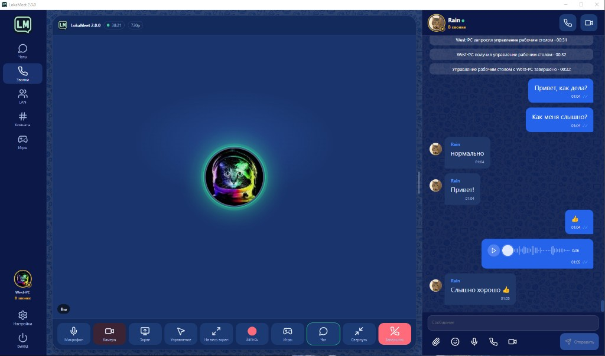

# LokaMeet

Десктоп‑приложение для мессенджера и видеосвязи в **локальной сети без интернета** (LAN‑only). Облако, аккаунт и внешний сервер не нужны.

Текущая версия: **2.0.0**

Репозиторий: https://github.com/mistrwest/LokaMeet



## Что нового

### 2.0.0

Добавлено: единое окно (чаты, LAN, комнаты, звонки, игры, настройки); конференции до 15 человек через mediasoup; голосовые, файлы, анимированные смайлы; статусы и авто‑«отошёл»; демонстрация экранов со звуком; управление рабочим столом с выбором монитора и полным экраном; запись MP4; виртуальный фон; portable и установщик.

Исправлено: пропадание звука после соединения, тихий голос, микрофон по голосу, линия между списком чатов и перепиской.

### 1.4.0

Добавлено: демонстрация экрана 60–120 кадр/с без обрезки, микрофон по голосу, игры с компьютером, параметры камеры только если устройство их отдаёт.

Исправлено: кадры трансляции, проглатывание слов, громкость при шумоподавлении, контур виртуального фона, автофокус.

### 1.3.0

Добавлено: одно сообщение со скриншотом/ссылкой/GIF, цитаты, «играть с собеседником», превью по клику, вставка без мгновенной отправки, подсветка записи, мигание на панели задач.

Исправлено: микрофон при выключении камеры, моргание статичной картинки при демонстрации.

### 1.2.0

Игры в звонке: шашки, шахматы, морской бой; зрители в конференции; сдача, ничья, реванш.

### 1.1.0

Камера и виртуальный фон, запись MP4/AVI, качество 360p–4K, камера докладчика, подтверждение выхода, отмена файла.

### 1.0.2

Установщик Windows, локализация RU/EN, индикаторы речи и статусов.

### 1.0.1

Первый публичный выпуск.

## Что это

Каждый клиент сам находит соседей в LAN (mDNS/Bonjour и UDP‑broadcast) и поднимает свой WebSocket‑сигналинг. Медиа идёт по WebRTC:

- личные звонки — напрямую (P2P);
- конференции — через хост комнаты (mediasoup), до **15** человек.

Сообщения, файлы, голос и картинка остаются внутри сети.

## Возможности

### Сеть

- Работа без интернета.
- Автообнаружение пользователей в LAN.
- Ручное подключение по IP и порту.
- Комнаты с именем и необязательным паролем.

### Чаты и файлы

- Личные чаты и чат комнаты.
- Текст, картинки, GIF, видео, голосовые, файлы, анимированные смайлы.
- Цитирование, правка, удаление, превью ссылок.
- Передача файлов по отдельному WebRTC DataChannel, перетаскивание и вставка из буфера.

### Звонки

- Аудио и видео один на один (P2P).
- Конференции до 15 человек через хост комнаты.
- Микрофон, камера, демонстрация экрана (монитор, окно, все экраны, звук компьютера).
- **Микрофон по голосу** с чувствительностью: звук уходит, пока вы говорите.
- Выбор микрофона и динамиков, усиление, шумоподавление, эхоподавление.
- Запись разговора в MP4, полный экран, свёртка в плашку.
- Виртуальный фон камеры (размытие, пресет или своя картинка).
- Управление рабочим столом: мигающий запрос, выбор монитора, мышь и клавиатура, полный экран картинки.

## Разделы

### Чаты

Личные переписки и чаты комнат. Текст, картинки, GIF, видео, файлы, голосовые и анимированные смайлы над полем ввода. Сообщение можно цитировать, править и удалять. Превью ссылок открывается в пузыре. Файлы идут отдельным WebRTC-каналом. История хранится на этом компьютере.

### LAN

Список людей, которые сейчас в сети. Можно написать, позвонить или подключиться вручную по IP и порту.

### Звонки

Журнал входящих, исходящих и пропущенных. Живой разговор один на один идёт напрямую: микрофон, камера, экран, управление столом, запись, игры, полный экран и свёртка.

### Комнаты

Временная комната с именем и необязательным паролем. Организатор поднимает конференцию до 15 человек. Когда он выходит, комната закрывается у всех.

### Управление рабочим столом

В звонке один просит доступ — кнопка мигает, пока нет ответа. Второй выбирает монитор и разрешает или отклоняет. Вы видите ровно этот экран, мышь и клавиши идут только по нему, картинку можно развернуть на весь экран. Пока хозяин стола водит свою мышь, она главная. Кто бы ни остановил управление, демонстрация этого стола выключается сразу.

### Запись

Кнопка в звонке пишет картинку сцены и общий звук в MP4. В чате видно, кто пишет и сколько это длится.

### Игры

Шахматы, русские шашки и морской бой: с человеком, с комнатой или с компьютером. Ходы остаются в локальной сети.

### Настройки

Профиль, статусы, темы, язык, звуки, устройства, виртуальный фон, папка записей, срок хранения файлов, сложность игр, лицензии сторонних компонентов. Журнал каждого запуска — английский файл в папке `logs` рядом с программой. Полный список функций 2.0.0 — в программе: Настройки → О программе.

## FAQ

**Нужен ли интернет?** Нет. Достаточно общей локальной сети.

**Собеседника нет в LAN.** Оба должны быть в одной сети, брандмауэр должен пускать LokaMeet в частных сетях. Если автопоиск молчит, подключитесь по IP и порту.

**Звонок есть, звука нет.** Включите микрофон кнопкой звонка и проверьте устройство. «Микрофон по голосу» молчит, пока вы не говорите.

**Синий курсор есть, а мышь собеседника стоит.** Синий курсор — ваш указатель на картинке. Настоящая мышь едет по монитору, который собеседник выбрал в запросе.

**Кто главнее?** Хозяин компьютера. Пока он двигает свою мышь, удалённые движения ждут. Сессия не отключается. Когда его курсор замер, ваш снова водит стол.

**Когда гаснет демонстрация?** Сразу, когда любой останавливает управление рабочим столом. Обычную демонстрацию без управления выключает кнопка «Экран».

**Сколько человек в конференции?** До 15 вместе с организатором. Личный звонок — всегда двое.

**Где данные и журнал?** Профиль и чаты — в каталоге данных приложения. Записи — в папке из настроек. Журнал — в `logs` рядом с программой.

### Игры (во время звонка или отдельно)

- Шахматы, русские шашки, морской бой.
- Игра с компьютером (легко / средне / сложно) или с собеседником.

### Интерфейс

- Темы оформления, масштаб шрифта, RU / EN.
- Профиль: имя, фото или видео‑аватар, статусы онлайн / отошёл / занят / невидимка, авто‑«отошёл».

## Быстрый старт (Windows)

Нужен [Node.js](https://nodejs.org/) (LTS).

```powershell
npm install
npm run build
npm start
```

Разработка:

```powershell
npm run dev
```

Портативная сборка — двойной щелчок по `build_portable.bat` (собирает EXE и открывает папку `release\`).

```powershell
.\build_portable.bat
```

В `release/` появится `LokaMeet-Portable-2.0.0.exe`.

Полный установщик + portable: `npm run dist`.

## Два окна на одной машине

```powershell
$env:LOKAMEET_PROFILE="A"
npm run dev
```

```powershell
$env:LOKAMEET_PROFILE="B"
npm run dev
```

Данные: `%AppData%\LokaMeet` (или `LokaMeet\A`, `LokaMeet\B`).

## Стек

Electron · React · TypeScript · WebRTC · mediasoup (конференции) · Vite · electron-builder.

## Лицензия

Автор: [mistrwest](https://github.com/mistrwest). Проект: https://github.com/mistrwest/LokaMeet

Сторонние компоненты, которые нельзя убирать из копий программы:

- анимированные смайлы — [Noto Emoji](https://github.com/googlefonts/noto-emoji), SIL Open Font License 1.1 (`public/emoji/LICENSE`, `public/licenses/noto-emoji-OFL.txt`);
- значки интерфейса — [Lucide](https://lucide.dev), ISC (`public/licenses/lucide-ISC.txt`);
- проигрыватель анимации — [lottie-web](https://github.com/airbnb/lottie-web), MIT (`public/licenses/lottie-web-MIT.txt`);
- конференции — [mediasoup](https://mediasoup.org), ISC (`public/licenses/mediasoup-ISC.txt`).

Полные тексты: [THIRD_PARTY_LICENSES.md](THIRD_PARTY_LICENSES.md). В программе — Настройки → О программе.
